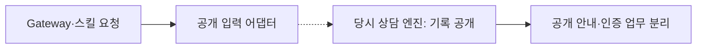
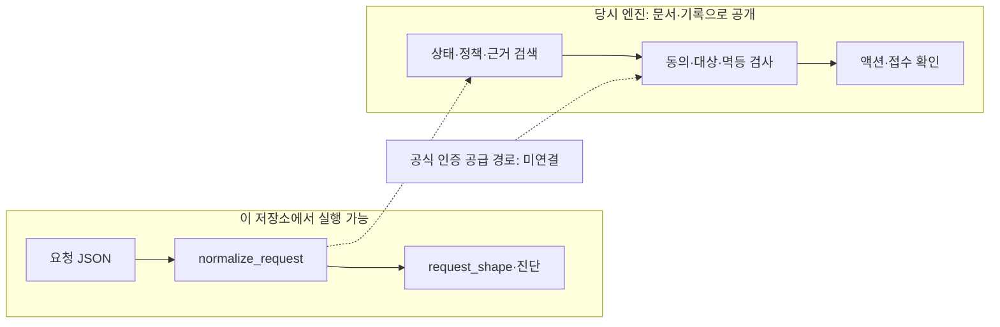
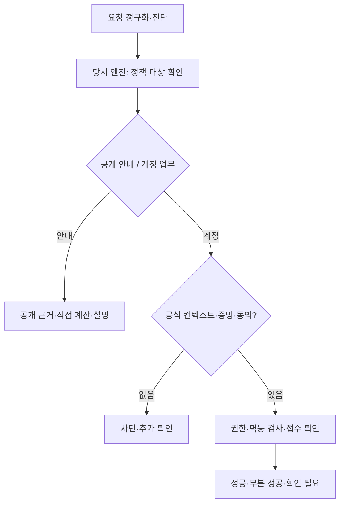

# AI TOP 100 2026 - 인터뷰에서 카카오 고객 상담 봇까지

2026년 10월 31일 10:00~15:00(KST), 대회 가상 마을의 관계자 인터뷰와 운영 자료를 바탕으로 고객 상담 에이전트를 구성한 과정입니다. 대회 전 범용 하네스·카카오 연결 기반을 활용했으며 모든 기능을 5시간 안에 처음부터 개발한 것은 아닙니다.

**공개 범위:** 회고·설계·검증 요약과 입력 정규화·구조 진단 코드 일부입니다. 전체 운영 봇과 공식 인증 컨텍스트 공급자는 공개본에서 재현되지 않습니다. 최종 일반 카카오 상담의 계정 액션은 0건이었습니다.



[빠른 실행](#빠른-실행) · [결과](#결과) · [문제](#문제정의) · [구조](#아키텍처) · [상세 흐름](#상세-워크플로우) · [데이터](#데이터) · [시도](#시도와-개선) · [평가](#평가와-재현) · [한계](#한계) · [기여](#기여와-ai-활용)

## 빠른 실행

저장소 루트에서 공개 입력 어댑터의 **독립 합성 테스트**를 실행합니다. 외부 API·카카오 계정·모델·추가 패키지가 필요 없습니다.

```console
python -m unittest discover -s tests -v
```

2026-11-15에는 **12개 테스트가 통과**했습니다. 당시 운영 회귀 245개와 별개이며 실제 환불·인증 연동을 뜻하지 않습니다. [공개 코드](examples/request_adapter.py), [테스트](tests/test_request_contract.py), [이번 실행 기록](docs/README_VERIFICATION.md)

## 결과

| 실행·기록 묶음 | 관측 | 해석 경계 |
|---|---|---|
| 당시 공개 TC 실습 | 최신 시도 15개, 43응답 p95 1.730초 | 지정 계정·주문, 기존 접수 재사용·여러 버전 집계 |
| 최종 일반 상담 | 고객 응답 6건 p95 2.998초, 계정 액션 0건 | 공식 회원 인증·TC·기준일 공급 경로 미확인 |
| 공개 코드 재현 | 입력 분리·혼합 형식 거부·값 없는 진단 12개 테스트 통과 | 운영 봇·실제 카카오 인입·환불 실행 아님 |

[기록 집계 JSON](evidence/summary.json)과 [측정 조건](docs/04-validation.md)을 함께 봅니다. 공식 점수·순위·심사 통과를 주장하지 않으며 서로 다른 묶음의 p95를 합치지 않습니다.

## 문제정의

“환불해주세요”를 처리하려면 답변 문장보다 먼저 주문 소유자, 대상 주문, 정책과 증빙, 고객 선택, 봇의 권한을 확인해야 했습니다. 관계자의 전언·광고·과거 처리 경험이 서로 충돌했고, 공개 안내와 인증된 주문 처리를 같은 입력으로 해결할 수 없었습니다.

인터뷰에서 알게 된 사실과 정책의 적용 조건을 보존하고, 필요한 정보만 묻고, 실행 조건이 확인된 API만 호출하는 방식으로 나눴습니다. 사용자는 실제 관계자 대화·카카오 재현과 우선순위 결정을 맡고, AI 도구를 자료 분석·구현·테스트에 활용했습니다.

## 아키텍처



| 책임·경계 | 확인 가능한 것 | 근거 |
|---|---|---|
| 공개 입력 어댑터 | 발화·대화 ID 분리, 혼합 형식 거부 | [request_adapter.py](examples/request_adapter.py) |
| 공개 진단 | 값·허용 목록 밖 키 이름을 숨기고 크기·중복 제한 | [독립 테스트](tests/test_request_contract.py) |
| 당시 상담·검색·액션 엔진 | 설계·측정·문제 해결 기록 | [아키텍처](docs/03-architecture.md) |
| 회원·TC·기준일 인증 | 공급 계약 미연결, 사용자 문자열로 승격하지 않음 | [회고](docs/05-retrospective.md) |

## 상세 워크플로우



아래는 당시 운영 설계와 관측 기록의 흐름입니다. **앞부분의 입력 정규화·값 없는 구조 진단만 이 공개 저장소의 코드로 직접 확인할 수 있고**, 이후 상담·액션 엔진은 [아키텍처 기록](docs/03-architecture.md)에서 확인합니다. 인증 컨텍스트 공급자는 미연결 상태입니다.

| 단계 | 처리와 경계 | 근거 |
|---|---|---|
| 1. 지식 준비 | 관계자 10명과의 대화·자료에서 사실·전언·정책·예외·공개 범위를 구분하고 파일 저장과 런타임 반영을 해시로 대조 | [인터뷰와 문제 해결](docs/02-problem-solving.md), [근거 목록](evidence/source-manifest.json) |
| 2. 입력 정규화 | Gateway와 스킬 형식을 별도로 읽고 발화·대화 ID를 분리. 고객의 TC 문자열이나 user ID를 주문 인증으로 승격하지 않음 | [normalize_request](examples/request_adapter.py) |
| 3. 구조 진단 | 키 경로·자료형·존재 여부만 기록. 값과 허용 목록 밖 키 이름을 숨기고 진단 크기·중복 수를 제한 | [request_shape·RequestDiagnostics](examples/request_adapter.py), [독립 공개 테스트](tests/test_request_contract.py) |
| 4. 상담과 검색 | 상태·정책과 공개 근거로 안내. 가격·SKU 계산은 확인된 값으로 직접 처리하고 Qwen은 근거 설명에 활용 | [아키텍처](docs/03-architecture.md) |
| 5. 인증과 대상 | 검증된 컨텍스트가 있을 때만 회원·TC·기준일을 대화에 연결. 주문 변경 시 이전 증빙·동의를 재사용하지 않음 | [인증 어댑터와 미연결 지점](docs/03-architecture.md) |
| 6. 실행과 결과 | 허용 API와 대상을 검사해 멱등 기록과 함께 접수. POST 결과 불명확 시 자동 재접수하지 않고 확인 필요 안내 | [부분 실패·시간 예산 처리](docs/03-architecture.md) |

### 최종 흐름은 어디에서 멈췄나

공개 TC 실습은 지정된 계정·주문·TC를 알고 있는 조건이었습니다. 일반 카카오 요청에서는 대화 ID와 발화는 확인했지만 공식 회원 인증·TC·상담 기준일을 받는 상류 계약을 연결하지 못했습니다. 서버 소유 컨텍스트와 서명 어댑터 구현만으로 공식 공급자가 생기지는 않습니다. 그래서 마지막 일반 상담은 응답했지만 계정 액션은 차단됐습니다.

공개 코드의 `handle_skill_request`도 프로세스 안의 어댑터입니다. 이 파일이 있다는 사실로 실제 스킬 HTTP webhook이 연결됐거나 전체 봇이 실행된다고 볼 수 없습니다. [회고와 다음 확인 순서](docs/05-retrospective.md)에 이 미완료 지점을 남겼습니다.

## 데이터

| 자료 | 사용·규모 | 공개 경계 |
|---|---|---|
| 가상 마을 관계자 인터뷰 | 10명, 정책·예외·채널 대조 | 원문 비공개. 실고객 수 아님 |
| 운영 지식 | 최종 검색 174레코드 | 내부 검색 단위, 공식 인정 지식 수 아님 |
| 공개 TC 기록 | 지정 계정·주문·TC 조건 | 원문·회원·주문·토큰·접수 DB 제외 |
| 공개 테스트 | 합성 사용자·발화·비정상 JSON | 개인 식별 정보가 없는 독립 입력 |
| 요약·해시 | 실행 묶음·시간·원본 해시 | [근거 목록](evidence/source-manifest.json), [요약](evidence/summary.json) |

## 시도와 개선

| 겪은 문제 | 선택한 해결 방법 | 결과와 남은 한계 |
|---|---|---|
| 전언·광고·현행 정책이 충돌 | 출처·시점·권한·적용 채널을 나누고 원본과 대조 | 인터뷰 10명, 최종 검색 174레코드. 공식 인정 지식 수나 실고객 수가 아님 |
| 답변과 실제 환불·이관을 혼동 | 명시적 동의·대상 검사·접수번호·부분 성공을 분리 | 모의 흐름과 공개 TC 실습 확인. 최종 일반 상담의 인증 액션 E2E는 미검증 |
| 반복 조회와 모델 대기로 지연 | 명확한 질문 직접 조회, 짧은 캐시·연결 재사용, 대화별 잠금·상주 STT | 같은 모의 15대화 API 호출 53→38. 같은 warm CPU 음성 비교 10.937→5.665초 |
| 입력 로그에 개인정보가 남을 위험 | 값 없이 허용 키·자료형만 진단, 알 수 없는 키도 숨김 | 공개 독립 테스트로 검사. 전체 운영 보안·공식 인증 완료를 뜻하지 않음 |
| 실습 성공이 최종 운영 성공으로 보임 | 모의·공개 TC·일반 카카오·공개 코드 검증을 따로 기록 | 최종 일반 상담에서 계정 액션 0건이라는 한계를 유지 |

## 평가와 재현

| 종류 | 확인 결과 | 재현·근거 | 범위 |
|---|---|---|---|
| 당시 운영 회귀·모의 흐름 | 정리 후 245개·예외 7개 | [측정 기록](docs/04-validation.md) | 공개 코드 12개 테스트와 별개 |
| 당시 공개 TC | 최신 시도 15개 | [summary.json](evidence/summary.json) | 깨끗한 초기화·동일 빌드 전체 재실행 아님 |
| 최종 일반 상담 | 인증 계정 액션 0건 | [일반 상담 기록](docs/04-validation.md) | 실제 인입→공식 인증→액션 E2E 미완료 |
| 공개 어댑터 재실행 | 2026-11-15: **12/12 통과** | [테스트](tests/test_request_contract.py), [실행 기록](docs/README_VERIFICATION.md) | 표준 라이브러리·합성 개발 계약, 운영 성공률 아님 |

모델·음성·API 성능 수치는 각각의 조건과 함께 해석합니다. 예컨대 같은 모의 15대화의 API 호출 53→38과 warm CPU 음성 비교 10.937→5.665초는 서로 다른 지표입니다. [재현·실패·측정 조건](docs/04-validation.md)

## 한계

| 한계 | 영향 | 현재 처리·다음 확인 |
|---|---|---|
| 공식 인증 컨텍스트 공급 미연결 | 일반 상담의 계정 액션을 검증하지 못함 | 차단 유지, 실제 인입→인증→주문 조회→최소 접수부터 재검증 |
| 전체 운영 봇·원문·DB 비공개 | 공개 코드만으로 전체 시스템 재현 불가 | 공개 어댑터와 당시 문서 기록의 경계를 표시 |
| 여러 버전·기존 접수 집계 | 공개 TC 수치를 단일 실행 합격률로 볼 수 없음 | 원 실행 묶음·측정 범위를 보존 |
| POST 결과 불명확·부분 성공 | 중복 접수·과장된 완료 안내 위험 | 자동 재접수하지 않고 확인 필요 안내 |

## 기여와 AI 활용

실제 인터뷰 전송, 자료 전달, 요구사항·우선순위 결정, 카카오 재현과 제출 전 판단은 사용자가 수행했습니다. AI 코딩 도구는 질문·자료 정리, 구현·패치·테스트·문서 작성을 도왔습니다(ai-assisted). 별도 채팅에서 병행한 자료 수집·상담 엔진 작업을 통합했으며, 이 공개본을 손으로 혼자 작성한 전체 운영 봇으로 소개하지 않습니다.

## 상세 문서와 이전 기록

[5시간 작업 기록](docs/01-five-hours.md) · [문제 해결](docs/02-problem-solving.md) · [구조](docs/03-architecture.md) · [검증](docs/04-validation.md) · [회고](docs/05-retrospective.md) · [공개 근거](docs/06-evidence-guide.md)

[이전 README 전체 기록](README_HISTORY.md)은 기존 시연·설치·기술 스택·기능별 기록과 측정 조건을 보존한 스냅샷입니다. 현재 실행 경계와 새 문서의 기준은 위 본문을 따릅니다. 이번 변경은 공개 코드·문서·평가 대조에 AI 코딩 도구를 사용했습니다(ai-assisted). 자동 병합하지 않습니다.
