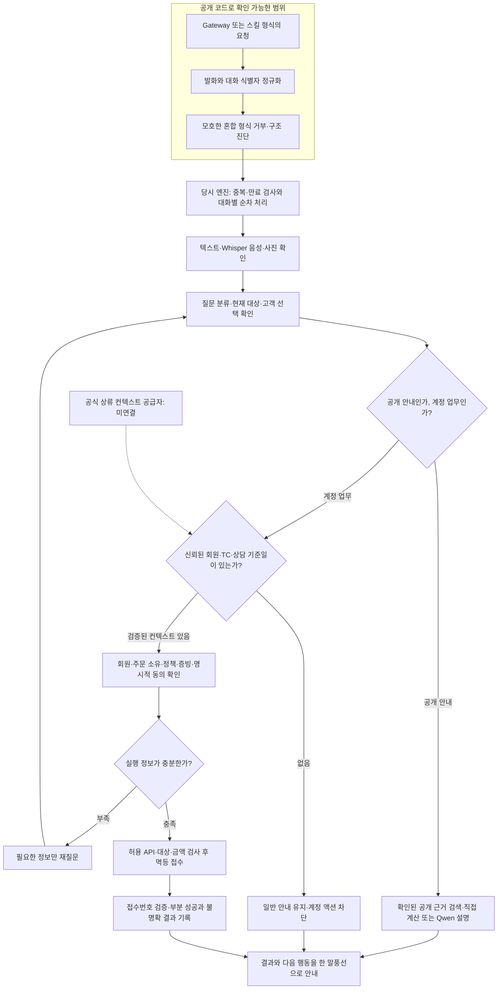

# AI TOP 100 2026 - 인터뷰에서 카카오 고객 상담 봇까지

2026년 10월 31일 10:00~15:00(KST), 대회 가상 마을의 관계자 인터뷰와 운영 자료를 바탕으로 고객 상담 에이전트를 구성한 과정입니다. 대회 전 범용 하네스·카카오 연결 기반을 활용했으며 모든 기능을 5시간 안에 처음부터 개발한 것은 아닙니다.

**공개본의 범위:** 회고·설계·검증 요약과 입력 정규화·구조 진단 코드 일부입니다. 전체 운영 봇·주문 데이터·접수 DB·모델은 포함하지 않습니다. **최종 일반 상담의 인증 정보 공급 경로를 확인하지 못했고 마지막 실제 카카오 검증의 계정 액션 호출은 0건**이었습니다.

[운영 흐름과 공개 코드 범위](#운영-흐름과-공개-코드-범위) · [문제와 해결 과정](#문제와-해결-과정) · [결과와 한계](#결과와-한계) · [5시간 작업 기록](docs/01-five-hours.md) · [검증 기록](docs/04-validation.md)

## 어떤 문제였나

“환불해주세요”를 처리하려면 답변 문장보다 먼저 주문 소유자, 대상 주문, 정책과 증빙, 고객 선택, 봇의 권한을 확인해야 했습니다. 관계자의 전언·광고·과거 처리 경험이 서로 충돌했고, 공개 안내와 인증된 주문 처리를 같은 입력으로 해결할 수 없었습니다.

인터뷰에서 알게 된 사실과 정책의 적용 조건을 보존하고, 필요한 정보만 묻고, 실행 조건이 확인된 API만 호출하는 방식으로 나눴습니다. 사용자는 실제 관계자 대화·카카오 재현과 우선순위 결정을 맡고, AI 도구를 자료 분석·구현·테스트에 활용했습니다.

## 운영 흐름과 공개 코드 범위

아래는 당시 운영 설계와 관측 기록의 흐름입니다. **앞부분의 입력 정규화·값 없는 구조 진단만 이 공개 저장소의 코드로 직접 확인할 수 있고**, 이후 상담·액션 엔진은 [아키텍처 기록](docs/03-architecture.md)에서 확인합니다. 인증 컨텍스트 공급자는 미연결 상태입니다.



| 단계 | 처리와 경계 | 근거 |
|---|---|---|
| 1. 지식 준비 | 관계자 10명과의 대화·자료에서 사실·전언·정책·예외·공개 범위를 구분하고 파일 저장과 런타임 반영을 해시로 대조 | [인터뷰와 문제 해결](docs/02-problem-solving.md), [근거 목록](evidence/source-manifest.json) |
| 2. 입력 정규화 | Gateway와 스킬 형식을 별도로 읽고 발화·대화 ID를 분리. 고객의 TC 문자열이나 user ID를 주문 인증으로 승격하지 않음 | [normalize_request](examples/request_adapter.py) |
| 3. 구조 진단 | 키 경로·자료형·존재 여부만 기록. 값과 허용 목록 밖 키 이름을 숨기고 진단 크기·중복 수를 제한 | [request_shape·RequestDiagnostics](examples/request_adapter.py), [독립 공개 테스트](tests/test_request_contract.py) |
| 4. 상담과 검색 | 상태·정책과 공개 근거로 안내. 가격·SKU 계산은 확인된 값으로 직접 처리하고 Qwen은 근거 설명에 활용 | [아키텍처](docs/03-architecture.md) |
| 5. 인증과 대상 | 검증된 컨텍스트가 있을 때만 회원·TC·기준일을 대화에 연결. 주문 변경 시 이전 증빙·동의를 재사용하지 않음 | [인증 어댑터와 미연결 지점](docs/03-architecture.md) |
| 6. 실행과 결과 | 허용 API와 대상을 검사해 멱등 기록과 함께 접수. POST 결과 불명확 시 자동 재접수하지 않고 확인 필요 안내 | [부분 실패·시간 예산 처리](docs/03-architecture.md) |

### 최종 흐름은 어디에서 멈췄나

공개 TC 실습은 지정된 계정·주문·TC를 알고 있는 조건이었습니다. 일반 카카오 요청에서는 대화 ID와 발화는 확인했지만 공식 회원 인증·TC·상담 기준일을 받는 상류 계약을 연결하지 못했습니다. 서버 소유 컨텍스트와 서명 어댑터 구현만으로 공식 공급자가 생기지는 않습니다. 그래서 마지막 일반 상담은 응답했지만 계정 액션은 차단됐습니다.

공개 코드의 `handle_skill_request`도 프로세스 안의 어댑터입니다. 이 파일이 있다는 사실로 실제 스킬 HTTP webhook이 연결됐거나 전체 봇이 실행된다고 볼 수 없습니다. [회고와 다음 확인 순서](docs/05-retrospective.md)에 이 미완료 지점을 남겼습니다.

## 문제와 해결 과정

| 겪은 문제 | 선택한 해결 방법 | 결과와 남은 한계 |
|---|---|---|
| 전언·광고·현행 정책이 충돌 | 출처·시점·권한·적용 채널을 나누고 원본과 대조 | 인터뷰 10명, 최종 검색 174레코드. 공식 인정 지식 수나 실고객 수가 아님 |
| 답변과 실제 환불·이관을 혼동 | 명시적 동의·대상 검사·접수번호·부분 성공을 분리 | 모의 흐름과 공개 TC 실습 확인. 최종 일반 상담의 인증 액션 E2E는 미검증 |
| 반복 조회와 모델 대기로 지연 | 명확한 질문 직접 조회, 짧은 캐시·연결 재사용, 대화별 잠금·상주 STT | 같은 모의 15대화 API 호출 53→38. 같은 warm CPU 음성 비교 10.937→5.665초 |
| 입력 로그에 개인정보가 남을 위험 | 값 없이 허용 키·자료형만 진단, 알 수 없는 키도 숨김 | 공개 독립 테스트로 검사. 전체 운영 보안·공식 인증 완료를 뜻하지 않음 |
| 실습 성공이 최종 운영 성공으로 보임 | 모의·공개 TC·일반 카카오·공개 코드 검증을 따로 기록 | 최종 일반 상담에서 계정 액션 0건이라는 한계를 유지 |

## 결과와 한계

당시 정리 후 회귀 245개와 모의 예외 흐름 7개 통과는 대회 실서비스 합격률이 아닙니다. 공개 TC 최신 시도 15개 집계도 여러 버전·지정 컨텍스트의 결과입니다. 43응답 p95 1.730초, 일반 상담 6건 p95 2.998초, 이후 구조 확인 3건 p95 5.501초는 각각 다른 측정 묶음이며 합치지 않습니다. 공식 점수·순위·심사 통과는 주장하지 않습니다. [측정 조건](docs/04-validation.md)에서 비교 대상을 확인할 수 있습니다.

공개 저장소에서 재현할 수 있는 범위는 아래 입력 정규화·진단 테스트입니다. 이 테스트는 포트폴리오 작성 시 추가했으며 당시 245개 운영 회귀와 별개입니다. 외부 API·카카오 계정·모델이 필요하지 않습니다.

```bash
python -m unittest discover -s tests -v
```

원본 인터뷰·대회 문서·이미지·음성·회원·주문·토큰·원문 채팅을 공개하지 않았습니다. 전체 실행 재현과 공식 인증 계약 검증이 어려운 점이 남아 있으며, 다음 시도에서는 실제 인입→인증→주문 조회→허용 접수의 최소 흐름을 먼저 확인할 계획입니다.

## 개인 기여와 AI 활용

실제 인터뷰 전송, 자료 전달, 요구사항·우선순위 결정, 카카오 재현과 제출 전 판단은 사용자가 수행했습니다. AI 코딩 도구는 질문·자료 정리, 구현·패치·테스트·문서 작성을 도왔습니다(ai-assisted). 별도 채팅에서 병행한 자료 수집·상담 엔진 작업을 통합했으며, 이 공개본을 손으로 혼자 작성한 전체 운영 봇으로 소개하지 않습니다.

---

<details>
<summary>시연·설치·기술 스택·기존 상세 기록 펼치기</summary>

**흩어진 운영 지식을 찾아, 5시간 안에 카카오톡 고객 상담 에이전트로 연결한 기록**

2026년 10월 31일 10:00~15:00(KST), 교동마을 산지직송 조합의 고객 상담 에이전트를 만드는 예선에 참여했다. 처음 주어진 것은 완성된 FAQ가 아니었다. 관계자를 찾아 인터뷰하고, 문서와 실제 운영 기록을 읽어 고객에게 무엇을 안내하고 어떤 처리를 해야 하는지 직접 알아내야 했다.

나는 관계자와 카카오톡으로 대화하고, 자료와 테스트 결과를 확인하며 우선순위를 정했다. AI 코딩 도구를 활용해 자료 정리와 Python 구현·테스트를 진행했고, 별도의 두 채팅에서 지식 수집과 상담 엔진 개발을 나눠 진행했다.

> 이 프로젝트는 완성된 운영 서비스의 성공 사례가 아니다. 공개 TC 실습에서는 지정된 계정·주문으로 처리 흐름을 확인했지만, 최종 일반 상담 모드에서는 심사용 인증 정보·TC ID 전달 경로를 확인하지 못했다. 마지막 실제 카카오 검증의 계정 액션 호출은 0건이었다. 그 차이와 원인도 이 포트폴리오에 포함했다.

## 어떤 문제를 풀었나

“환불해주세요”라는 한 문장에도 확인할 것이 많았다. 어느 주문인지, 본인 주문인지, 하자가 확인됐는지, 고객이 환불을 선택했는지, 봇의 권한 안에 있는지에 따라 처리 방식이 달랐다. 상품 설명과 광고가 충돌하거나, 과거 상담 사례가 현행 규정과 다른 경우도 있었다.

그래서 문제를 세 부분으로 나눴다.

1. **알아야 할 것:** 관계자 인터뷰와 원본 자료에서 사실·정책·예외·권한을 구분한다.
2. **물어봐야 할 것:** 주문번호, 상세주소, 환불 사유와 고객 선택이 없으면 필요한 정보만 다시 묻는다.
3. **실행해도 되는 것:** 검증된 상담 정보, 주문 소유 관계, 정책, 명시적 동의를 확인한 후 Python 코드가 API를 호출한다.

## 맡은 일과 구현

| 영역 | 진행한 일 |
|---|---|
| 인터뷰 | 운영자에서 시작해 소개 경로를 따라 관계자 10명과 대화, 원본 자료 확보와 교차 확인 |
| 지식 관리 | 확인 상태·출처·적용 조건·예외·공개 범위를 보존하고, 파일 저장과 런타임 반영을 별도 검증 |
| 상담 엔진 | 사용자별 상태, 대상 주문 선택, 부족한 정보 재질문, 주제 전환, 부정·철회 의사 처리 |
| 액션 연결 | OpenAPI 기반 조회·접수, 대상 제한, 접수번호 검증, 중복 요청 방지와 부분 성공 안내 |
| 멀티모달 | Whisper-small 음성 인식과 로컬 Qwen 비전 모델의 사진 확인 연결 |
| 성능 | 명확한 상품 질문의 직접 조회, 짧은 캐시, 연결 재사용, 대화별 잠금, STT 작업자 상주 |
| 검증 | 실패 대화 재현 → 패치 → 회귀 검사 → 사용자가 실제 카카오에서 전송 → 서버 기록 대조 |

기술: **Python · Qwen3.8 27B(로컬 모델 설정명) · Ollama · Whisper-small · httpx · WebSocket · SQLite · pytest**. 대회 전에 만든 범용 하네스와 카카오 연결 기반을 활용했다. 모든 기능을 당일 5시간 안에 처음부터 만든 것은 아니다.

## 확인한 결과

| 결과 | 수치 | 해석 범위 |
|---|---:|---|
| 관계자 연결·대화 | 10명 | 대회 가상 마을 관계자. 실제 고객 수가 아님 |
| 마지막 확인 발굴률 단순 평균 | 45.8% | 관계자별 `./status` 표시 평균. 전체 참가자 평균·최종 점수가 아님 |
| 최종 공개 검색 대상 | 174레코드 | 내부 검색 단위. 공식 인정 지식 수와 다름 |
| 최종 정리 후 회귀 검사 | 245개 통과 | 로컬·모의 검증 포함. 심사 합격률이 아님 |
| 예외 흐름 재현 검사 | 7개 통과 | 모의 API. 실제 접수와 구분 |
| 공개 TC 실습 최신 시도 집계 | 15개 처리 기준 충족 | 고정 실습 정보, 기존 접수 재사용, 여러 버전의 최신 시도 합산 |
| 해당 실습 43응답의 p95 | 1.730초 | 서버 수신→콜백 완료. 공식 심사 지표가 아님 |
| 일반 상담 전환 후 고객 응답 6건 p95 | 2.998초 | 사진 포함 소표본. 인증된 계정 액션 없음 |
| 이후 요청 구조 확인 3건 p95 | 5.501초 | 다른 질문·측정 묶음. 위 표본과 합치지 않음 |

같은 15개 모의 대화에서 API 호출은 **53→38회**, 원본 음성의 같은 warm CPU 작업자 비교에서는 인식 시간이 **10.937→5.665초**로 줄었다. 성능 수치의 측정 조건과 한계는 [검증 기록](docs/04-validation.md)에 따로 적었다.

## 읽는 순서

- [10시부터 15시까지: 무엇을 바꿔가며 풀었나](docs/01-five-hours.md)
- [문제를 어떻게 해석했나: 인터뷰와 정책 충돌](docs/02-problem-solving.md)
- [상담·인증·액션의 전체 구조](docs/03-architecture.md)
- [실패 재현, 패치, 실제 검증 결과](docs/04-validation.md)
- [남은 문제와 다음에 바꿀 접근](docs/05-retrospective.md)
- [근거와 공개 범위](docs/06-evidence-guide.md)

## 코드로 확인하기

이 저장소에는 전체 운영 봇 대신, 당시 구현의 **입력 정규화·값을 남기지 않는 구조 진단 모듈**을 선별해 담았다. 원본 파일의 SHA256은 [근거 목록](evidence/source-manifest.json)에 있다. 공개용 독립 테스트는 대회 후 포트폴리오 작성 시 추가했으며, 당시 245개 테스트와 별개다.

```bash
python -m unittest discover -s tests -v
```

외부 API·카카오 계정·모델 다운로드 없이 실행한다. 이 테스트로 실제 환불이나 인증 연동 성공을 주장하지 않는다.

## 공개 범위

원본 인터뷰, 대회 제공 문서·이미지·음성, 회원·주문 데이터, 토큰, `.env`, 접수 DB와 원문 채팅은 올리지 않았다. 문서는 두 채팅과 로컬 검증 산출물을 대조해 새로 작성했다. 운영 프로젝트나 배포본을 이 작업으로 변경하지 않았다. 대회 공식 점수·순위·심사 통과 여부는 이 저장소의 주장에 포함하지 않는다.

</details>
