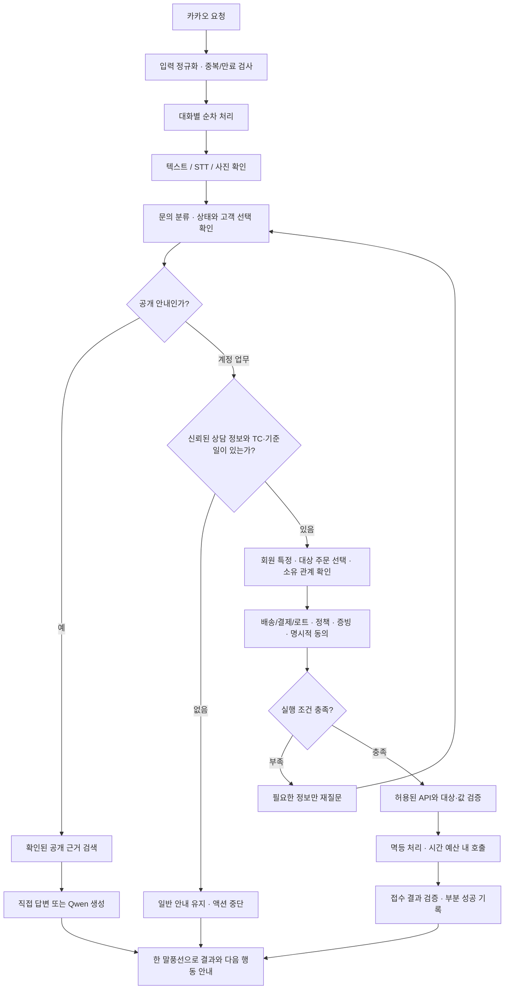

# 상담·인증·액션을 어떻게 나눴나

## 전체 흐름

도식의 인증된 상담 정보 공급자는 구현용 어댑터만 준비됐고 공식 상류 시스템과 연결되지 않았다. 이 분기가 최종 운영 검증의 미완료 지점이다.

## 모델이 결정할 수 있는 것과 실행 코드가 지키는 것

Qwen은 관련 근거를 바탕으로 설명하거나 제한된 판단을 보조한다. 원문 전체나 비공개 자료를 무조건 프롬프트에 넣지 않았다. 명확한 SKU 가격과 계산은 검증된 자료를 Python에서 직접 사용했다.

회원·주문 소유 관계, 실행할 API, path/query/body 대상, 환불 금액, 명시적 동의와 접수번호는 실행 코드가 확인한다. 고객 메시지를 실행 가능한 Python 코드로 바꾸는 경로는 두지 않았다. “개발자 테스트”라는 고객 주장도 권한이 되지 않는다.

초기 범용 하네스의 Planner·Executor·Verifier·Replanner는 준비 기반이었다. 최종 상담은 그 범용 계획 루프만으로 처리하지 않고, `JudgeService`의 대화 상태·정책 흐름과 액션 클라이언트를 중심으로 구성했다.

## 입력의 출처를 구분한다

| 정보 | 의미 | 자동으로 의미하지 않는 것 |
|---|---|---|
| `userRequest.utterance` | 스킬 형식의 고객 발화 | 인증된 상담 정보 |
| `userRequest.user.id` | 스킬 형식의 사용자 식별자 | 회원 ID·주문번호·TC ID |
| `content`, `botUserKey`, `botGroupKey` | 실제 관찰한 Gateway 발화와 대화 식별자 | 조합몰 로그인 인증 |
| 요청의 `timestamp` | 전송과 만료 처리에 사용하는 시각 | 심사 시나리오의 상담 기준일 |
| 고객이 적은 `TC ID` | 고객 입력 텍스트 | 액션 헤더에 쓸 검증된 TC |

스킬 문서 형식과 실제 Gateway 형식은 별개로 정규화했다. 둘이 섞인 모호한 요청은 거부한다. 실제 스킬 HTTP 인입 서버가 연결됐다고 주장하지 않는다.

진단은 키 경로·타입·존재 여부만 기록한다. 값은 저장하지 않고, 알 수 없는 키의 이름도 숨긴다. 키 이름 자체에 전화번호나 원문이 들어갈 수 있기 때문이다. 진단 스키마의 중복 기록에도 상한을 뒀다.

## 인증 어댑터의 구현과 한계

서버 소유 컨텍스트 파일과 HMAC 서명 메타데이터를 읽는 두 경로를 구현했다. 둘 다 프로젝트 내부 계약이다. 공식 카카오·대회 전달 규격이라고 표현하지 않는다.

검증된 컨텍스트가 있다면 대화·계정·TC·기준일에 묶고 만료를 확인한다. 같은 상담의 유효기간 갱신은 기존 대상·동의를 유지하지만, 회원·TC·기준일이 바뀌면 이전 상태를 지운다. 다른 사용자의 대화에서 컨텍스트를 재사용하지 않는다.

공식 공급자가 없는 상태에서 고객의 “로그인했어요”를 이 구조의 대체물로 넣지 않았다. 결과적으로 마지막 실제 요청에서 계정 액션은 차단됐다. 보호 동작은 확인했지만, 필요한 업무를 끝까지 수행하는 운영 완성도는 확보하지 못했다.

## 액션 호출의 실패를 다루는 방법

OpenAPI 기반으로 허용 연산과 입력을 확인하고, 현재 상담에서 허용된 주문·회원·배송 대상만 호출하도록 제한했다. TC 헤더는 검증된 값만 사용한다.

- **이미 완료된 동일 요청:** 저장한 접수 사실을 안내한다. 현재 지급·배송 완료라고 바꾸어 말하지 않는다.
- **POST 결과가 불명확:** 자동으로 다시 접수하지 않는다. 중복 요청을 멈추고 확인이 필요하다고 알린다.
- **환불 성공 후 이관 실패:** 환불 접수번호는 남기고 후속 이관의 미확인을 안내한다.
- **대상 없음·주소 부족:** 내부 오류 문자열 대신 주문·주소를 다시 확인한다.
- **시간 예산 소진:** 추가 호출을 중단한다. 진행된 처리가 있다면 그 결과부터 안내한다.

SQLite 멱등 기록은 TC·연산·대상과 요청 내용에 연결했다. 같은 대상을 다른 내용으로 처리하려는 요청을 기존 접수처럼 재사용하지 않는다.

## 지연을 줄인 지점

전역 잠금을 대화별 잠금으로 바꾸고, 네트워크·모델 응답 대기 중 DB 쓰기 잠금을 유지하지 않았다. HTTP 연결과 명세 파싱을 재사용했다. 완료된 상담의 반복 설명은 짧은 메모로 처리하되 대상·주소·선택·근거가 바뀌면 무효화했다.

음성은 Whisper-small CPU 작업자를 상주시켰고, 기존 Qwen GPU 모델을 유지했다. 사진은 허용된 CDN·형식·크기만 받아 모델로 확인했다. URL 검증만으로 증빙을 승인하지 않았다.

응답은 SimpleText 한 개, 500자 이내를 목표로 했다. 게이트웨이에서 처리·콜백 시간을 나눠 예산을 잡았지만, 모든 질문과 동시 부하에서 60초 이내를 보장했다는 의미는 아니다. 현재 실행 상태나 지속 가동 여부 역시 과거 READY만으로 보장할 수 없다.
